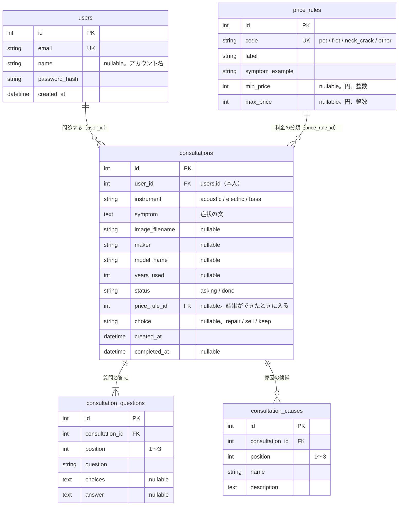

# データベース設計

[要件定義（requirements.md）](../spec/requirements.md)と[画面一覧（screens.md）](screens.md)をもとにする。

 

## ER 図

 

## カラム定義

### users

| カラム | 型 | 制約 | 説明 |
|-|-|-|-|
| id | Integer | PK | |
| email | String(255) | not null, unique | 小文字にそろえて保存する。画面には出さない |
| name | String(30) | nullable | アカウント名。画面の上の帯に出す。登録のときは必須（フォームで確かめる）。この欄ができる前に登録した人は空 |
| password_hash | String(255) | not null | `generate_password_hash` の結果。平文は保存しない |
| created_at | DateTime | not null, default 現在時刻（日本時間） | 登録日時 |

ロールは持たない。

### consultations（問診）

| カラム | 型 | 制約 | 説明 |
|-|-|-|-|
| id | Integer | PK | |
| user_id | Integer | not null, FK users.id | 問診した本人 |
| instrument | String(20) | not null | `acoustic` / `electric` / `bass`（Python 側は `Instrument` の StrEnum） |
| symptom | Text | not null | 症状の文。1,000文字まで（フォームで確かめる） |
| image_filename | String(255) | nullable | サーバーが付け直したファイル名。写真が無ければ空 |
| maker | String(50) | nullable | メーカー（任意）。AI に、症状と一緒に渡す |
| model_name | String(50) | nullable | 機種名（任意）。AI に、症状と一緒に渡す |
| years_used | Integer | nullable | 使用年数（任意）。0〜100（フォームで確かめる）。AI に、症状と一緒に渡す |
| status | String(20) | not null, default `asking` | `asking`（質問に答える前） / `done`（結果あり）。Python 側は `ConsultationStatus` の StrEnum |
| price_rule_id | Integer | nullable, FK price_rules.id | AI が選んだ料金表の分類。`done` になるときに入る |
| choice | String(20) | nullable | `repair`（修理を依頼） / `sell`（買取査定） / `keep`（そのまま使う。ボタンは「ホームに戻る」）。Python 側は `Choice` の StrEnum |
| created_at | DateTime | not null, default 現在時刻（日本時間） | 問診を始めた日時。今日の回数を数えるのに使う |
| completed_at | DateTime | nullable | 結果ができた日時 |

### consultation_questions（質問と答え）

| カラム | 型 | 制約 | 説明 |
|-|-|-|-|
| id | Integer | PK | |
| consultation_id | Integer | not null, FK consultations.id | |
| position | Integer | not null | 1〜3。画面に出す順番 |
| question | String(255) | not null | AI が作った質問 |
| choices | Text | nullable | AI が作った答えの選択肢。1行に1つ（2〜4個、1つ30文字まで）。無い質問は NULL |
| answer | Text | nullable | 本人の答え。500文字まで（フォームで確かめる） |

`(consultation_id, position)` に unique 制約を付ける。

### consultation_causes（原因の候補）

| カラム | 型 | 制約 | 説明 |
|-|-|-|-|
| id | Integer | PK | |
| consultation_id | Integer | not null, FK consultations.id | |
| position | Integer | not null | 1〜3。可能性が高い順 |
| name | String(100) | not null | 原因の名前 |
| description | Text | not null | 短い説明 |

`(consultation_id, position)` に unique 制約を付ける。

### price_rules（料金表）

| カラム | 型 | 制約 | 説明 |
|-|-|-|-|
| id | Integer | PK | |
| code | String(50) | not null, unique | AI に選ばせる分類のコード |
| label | String(50) | not null | 画面に出す分類の名前 |
| symptom_example | String(255) | not null | 症状の例。AI に分類を選ばせるときに渡す |
| min_price | Integer | nullable | 下限。円の整数 |
| max_price | Integer | nullable | 上限。円の整数 |

 

### diagnosis_guides（診断の手引き）

症状ごとに、確かめる点と見分け方を持つ表。工房の職人が、中身を直していく。
AI は、書かれた症状に近い行があれば、その行に沿って質問と診断を作る。近い行が無ければ、使わない。
ほかの表とは、外部キーでつながない（`category_code` は、料金表の `code` と同じ文字を書く）。

| カラム | 型 | 制約 | 説明 |
|---|---|---|---|
| id | Integer | PK | |
| code | String(50) | not null, unique | 行の名前（例：`tone_no_change`） |
| symptom | String(255) | not null | 持ち主が書きそうな言葉で書いた症状 |
| causes | Text | not null | 考えられる原因。「／」で区切る |
| checks | Text | not null | 確かめる点。「／」で区切る |
| how_to_tell | Text | not null | 見分け方。「／」で区切る |
| category_code | String(50) | not null | 料金表の分類（`price_rules.code`） |

初期データは、`monshin/commands.py` の `DIAGNOSIS_GUIDES` に書く。`flask seed` で入る（何度実行してもよい）。
今の中身は、職人の確認の前のたたき台である。

## 料金表の初期データ

`uv run flask seed` で入れる（`monshin/commands.py`）。同じ `code` があれば、作り直さずに値を更新する。

| code | label | symptom_example | min_price | max_price |
|-|-|-|-:|-:|
| pot | ポットの不良 | ノブが効かない。回すと雑音が出る | 3000 | （空） |
| fret | フレットの消耗 | 音が詰まる。フレットがへこんでいる | 16000 | 90000 |
| neck_crack | ネックの折れ、ひび | ヘッドやネックが割れた | 65000 | （空） |
| jack | ジャック（ケーブルの差し込み口）の不良 | ケーブルを動かすと音が途切れる。差し込み口がぐらつく | 1800 | 4500 |
| switch | 切り替えスイッチの不良 | 一部の位置だけ音が出ない。切り替えると雑音が出る | 2500 | 6500 |
| wiring | アース・配線の不良 | ジーという雑音がずっと出る。弦に触れても変わらない | 2800 | 17000 |
| neck_adjust | ネックの反り・弦の高さの調整 | 全体的にビビる。弦が高くて押さえにくい | 1800 | 8500 |
| nut | ナット（弦を支える溝の部品）の不良 | 開放弦だけビビる。合わせるときにキンと鳴って、音が狂う | 1700 | 13000 |
| peg | ペグ（糸巻き）の不良 | 糸巻きがガタつく、空回りする | 1200 | 5500 |
| bridge | ブリッジのはがれ（アコースティック） | ブリッジの後ろにすき間がある。浮いている | 5500 | 32000 |
| body | ボディの割れ・膨らみ（アコースティック） | 表の板が割れた、膨らんでいる | 2500 | 32000 |
| other | その他、判断できない | 上のどれにも当たらない | （空） | （空） |

 

## メモ

- 金額は円の整数で持つ。AI には金額を作らせない。AI は `code` を1つ選ぶだけである。
- AI が返した `code` が料金表に無いときは、`other` にする。
- 今日の回数は、「本人の問診のうち、`created_at` が今日の 0:00（日本時間）以降のもの」を数える。0:00 の時刻は Python で作り、SQLAlchemy の比較で絞る。SQLite 専用の日付の関数を使わない。
- 結果の画面の料金は、表示するたびに `price_rules` から引く。問診の側に金額の写しは持たない（デモ用のため）。
- 問診は削除しない。削除の画面も作らない。
- 写真のファイルは、公開されないフォルダーに置く。場所は設定 `UPLOAD_FOLDER`（既定は `instance/uploads/`）。`static/` の下には置かない。ファイル名は、推測できない乱数にサーバーが付け直す。Git には入れない。
- 写真は `GET /consultations/<id>/photo` からだけ返す。この URL は、ログインと所有者を確かめる。`image_filename` を URL やフォームから受け取らない（DB の値だけを使う）。
- 音声と買い取りは「側だけ」なので、テーブルもカラムも作らない。
