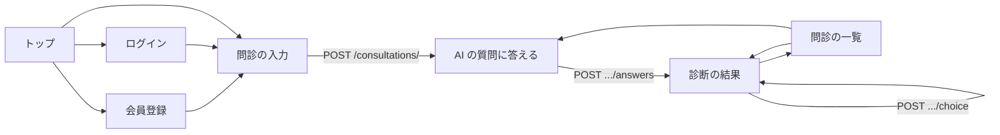

# 画面一覧

[要件定義（requirements.md）](../spec/requirements.md)をもとにする。

 

## ユーザーストーリー

| 誰が | 何をしたい | なぜ |
|-|-|-|
| 楽器の持ち主 | 症状を伝えて、原因の候補を知りたい | 何が壊れているのか、自分ではわからないから |
| 楽器の持ち主 | 修理に出す前に、料金の見積を知りたい | 料金がわからないと、修理に出す決心がつかないから |
| 楽器の持ち主 | 直すか、手放すか、そのまま使うかを選びたい | 料金を見てから、楽器をどうするか決めたいから |
| 楽器の持ち主 | 過去の問診を見返したい | あとで修理に出すときに、内容を伝えたいから |

 

## 画面

| 画面名 | URL | ログインが必要か | 見られる人 | 表示するもの・できること |
|-|-|:-:|-|-|
| トップ | `/` | 不要 | 誰でも | アプリの説明。「AI 見積を始める」のボタン（ログインしていなければ、ログインの画面へ移る） |
| 会員登録 | `/register` | 不要 | ─ | アカウント名、メールアドレス、パスワード |
| ログイン | `/login` | 不要 | ─ | メールアドレス、パスワード |
| 問診の入力 | `/consultations/new` | 必要 | ログインした人 | 楽器の種類（アコースティックギター／エレキギター／ベース）、症状（必須）、写真（任意、1枚）、メーカー・機種名・使用年数（どれも任意）、「音声・動画を追加（任意）」の欄（ファイルは選べるが、送らない）。「AI 見積を始める」。今日の上限に達していたら、その旨を出し、送れないようにする |
| AI の質問に答える | `/consultations/<id>/questions` | 必要 | 本人だけ（他人の問診は 403） | 入力した症状、AI の質問3つ、それぞれの答えの欄（3つとも必須）。「結果を見る」 |
| 診断の結果 | `/consultations/<id>` | 必要 | 本人だけ（他人の問診は 403） | 楽器、症状、写真、質問と答え、原因の候補（最大3つ。名前と説明）、料金の見積、3つの出口のボタン（修理依頼に進む／ホームに戻る／買取査定をする）。選んだあとは、選んだ出口を出す。「修理依頼に進む」では「修理の依頼」の枠、「買取査定をする」では「買取査定」の枠を出す。「ホームに戻る」では、トップへ移る |
| 問診の一覧 | `/consultations/` | 必要 | ログインした人（自分の問診だけ） | 自分の問診を新しい順に。日時、楽器、症状の先頭、状態、選んだ出口。結果へのリンク |

### 画面の遷移

- 会員登録が済むと、自動でログインした状態になる。ログインの画面は通らない。
- 状態が「質問に答える前」の問診を、結果の URL で開いたときは、質問の画面へ移す。
- 状態が「結果あり」の問診を、質問の URL で開いたときは、結果の画面へ移す。

 

## 写真を返す URL（画面ではない）

| URL | 内容 | ログインが必要か | 見られる人 |
|-|-|:-:|-|
| `GET /consultations/<id>/photo` | その問診の写真のファイルを返す。写真が無い問診は 404 | 必要 | 本人だけ（他人の問診は 403） |

- 写真は、公開のフォルダー（`static/`）に置かない。この URL からだけ返す。
- 結果の画面と質問の画面の `` は、この URL を指す。
- ログインしていない人がこの URL を開くと、ログインの画面へ移る。

 

## POST だけの URL（画面ではない操作）

| URL | 内容 | ログインが必要か | 使える人 |
|-|-|:-:|-|
| `POST /logout` | ログアウト | 必要 | ログインした人 |
| `POST /consultations/` | 問診を作る。下の「問診を作るときの順番」のとおりに処理する | 必要 | ログインした人 |
| `POST /consultations/<id>/answers` | 3つの答えを保存する。AI を呼んで結果を作り、保存する。状態を「結果あり」にする | 必要 | 本人だけ |
| `POST /consultations/<id>/choice` | 選んだ出口（修理を依頼／買取査定／そのまま使う）を保存する。選び直せる。「ホームに戻る」のときは、トップへ移る | 必要 | 本人だけ |

### 問診を作るときの順番（`POST /consultations/`）

1. 入力を確かめる（症状が空でないか。写真の種類と大きさ）。
2. 今日の問診の数を数える。5回に達していたら、作らずに、その旨を出す。
3. AI を呼んで、質問を3つ作る。写真があれば、写真も渡す。
4. AI が成功したら、写真を保存し、問診と質問を保存して、質問の画面へ移す。
5. AI が失敗したら、何も保存しない。入力した文を残したまま、入力の画面に「今は AI を使えません」と出す。写真は選び直してもらう。

### 結果を作るときの順番（`POST /consultations/<id>/answers`）

1. 3つの答えを確かめて、保存する。
2. AI を呼ぶ。渡すものは、楽器、症状、質問と答え、写真（あれば）、料金表の分類の一覧。
3. AI は、原因の候補（最大3つ）と、料金表の分類を1つ返す。
4. AI が返した分類が料金表に無いときは、「その他、判断できない」にする。
5. 原因の候補と分類を保存し、状態を「結果あり」にして、結果の画面へ移す。
6. AI が失敗したら、答えは保存したまま、質問の画面に「今は AI を使えません」と出す。もう一度送ると、やり直せる。

 

## 料金の見積の出し方

料金表の分類が持つ下限と上限で決める。金額は「3,000円」の形式（3桁ごとのカンマ＋円）。

| 料金表の中身 | 表示 |
|-|-|
| 下限と上限がある | `16,000円〜90,000円` |
| 下限だけがある | `3,000円〜` |
| どちらも無い | `要見積` |

 

## 「側だけ」のもの

| もの | 画面に出すもの | 作らないもの |
|-|-|-|
| 音声のアップロード | 問診の入力の画面に、欄「音声・動画を追加（任意）」（ファイルは選べるが、送らない） | ファイルの受け取り、保存、AI による読み取り。音声のファイルが送られてきても、無視する |
| 買い取りの提案 | 結果の画面で「買取査定をする」を選んでいるときに、枠「買取査定」 | 金額、査定、申し込み |

 

## メモ

- 値を変える操作は、すべて POST にする。GET のリンクで値を変えない。
- 問診は削除できない。編集もできない（出口の選び直しだけできる）。
- 失敗した問診（AI が失敗して保存されなかったもの）は、今日の回数に数えない。
